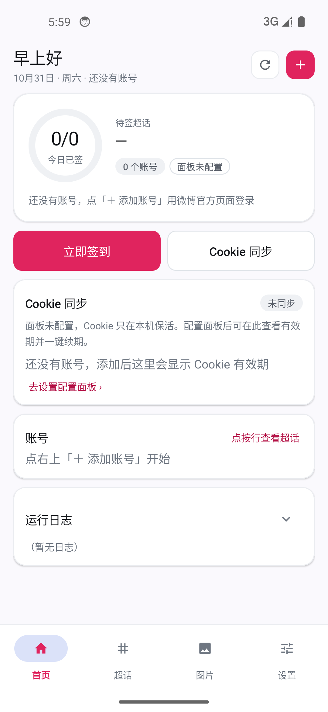
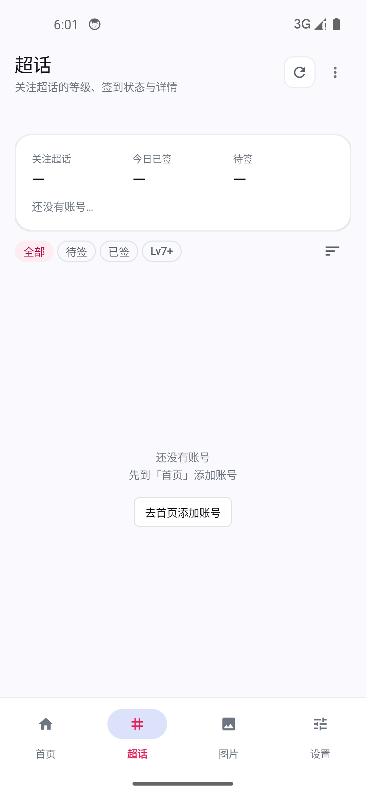

# 微博签到助手 · Android 客户端

「微博超话签到管理面板」的手机端（Kotlin / Android，包名 `com.wcm.checkin`）。
把登录态的「根」放到手机上：App 内用微博官方页面登录一次（默认账密不经本应用），
之后在真机 + 家宽/移动网络上直接签到，并把最新 Cookie 同步回面板。
登录态与账号密码、ALC 票据一律用 Android Keystore 加密落盘（v0.11.0 起 cookie 也加密）。
可选开启「自动重登」：Cookie 失效或临期时，用本机加密保存的账号密码走微博 SSO 重新登录，
或改用 `ALC` 票据重签（不碰密码）。

> 本工程原为面板仓库的 `android-app/` 目录，已独立为单独项目，可脱离面板单独
> 构建与迭代。面板侧文档见同级目录 `微博签到/`。

## 功能

- **打开 App 即自动签到**：逐账号列超话 → 对未签的超话随机间隔 3-8 秒逐个签到
  （已签自动跳过，与面板互相幂等）
- **账号列表**：每个账号分三行显示「用户名 / UID / 状态」；昵称解析对齐面板端
  （递归找 screen_name，Web 端资料接口优先），登录、进首页、后台保活三处都会自动补拉，
  不会再长期停在「（未获取到昵称）」（v0.9.10）。状态第一行答「**今天**签了吗」：
  今日超话快照优先（`今日已全部签到 · 7/7` / `今日已签 4/7，还有 3 个未签`），
  快照不可用时才退回本机上一次小结并标明「上次」（v0.9.16）
- **超话面板（v0.9.0）**：底部「超话」页把接口能读到的超话信息集中展示 ——
  账号切换、关注总数 / 今日已签 / 待签三列概览、逐条的**等级徽章（四档配色）**、
  名称、签到状态，可按待签/已签/Lv7+ 筛选、按待签优先/等级/名称排序；
  点开某条才懒加载简介、关注数、帖子数与超话 ID（缓存 30 分钟），
  行菜单可单独签到 / 复制签到链接 / 查看该条原始 JSON；⋮ →「字段说明」列出全部可读字段
- **超话状态与补签**：**打开 App 时自动刷新一次**各账号的超话签到状态（切 Tab 回来不再重拉，
  需要最新状态时点「刷新超话」）；点按账号行会列出该账号**关注的全部超话并逐条标注已签/待签**，
  勾选漏签的一键补签，弹窗里的「查看全部」直接跳到超话页；账号行额外显示该账号的最高超话等级，
  Hero 卡可点进超话页，底栏「超话」上挂着待签数角标
- **原图抓取**：添加博主（UID / 主页链接 / 个性域名）并选择相册目录后，一键增量
  抓取其全部原创微博原图（`/large/` 原始分辨率）；Live Photo 端内转 GIF
  （自研 GIF89a 编码器：中值切分 256 色调色板 + LZW + Bayer 抖动，12fps/长边 640，
  失败自动回退保存原始视频），按日期命名平铺，**游标驱动、断点续跑、三层去重**；
  Live 项只存动图，不再额外存一张重复的封面静图（关掉 GIF 转换、只留 mov 时才补封面）
- **抓取进度可视化（v0.9.0）**：运行卡显示阶段（补失败 / 补新 / 补历史 / 全量扫描）、
  已处理/计划、当前目标、已下载/跳过/待重试计数与进度条；「停止」对首页自动抓图同样生效；
  有待重试的帖子会出现「待重试 N 帖」入口，可查看清单并一键只跑重试阶段
- **单博主全量 / 增量抓取（v0.9.12）**：抓取目标行右侧 ⋮ 菜单里新增
  「增量抓取（仅此博主）」「全量抓取（仅此博主）」，运行卡下方另有「全量抓取（全部目标）」，
  确认后即只跑选中的范围。**增量**沿用原来的两段式（补新 → 补历史），只沿着水线补缺口；
  **全量**则从最新一页开始**连续往下翻**，不承认已有覆盖区间、只信索引里的终态，
  专门用来补历史空洞（旧版本按连续计数误判、置顶帖绕过判定、中途断掉留下的缺口，增量永远不回头）。
  全量不重复下载：已完整的帖只花一次列表请求；进度按页存档（`scanPage`）与增量锚点分开，
  预算用完下一轮从下一页续，翻页失败留在原页重试，起始日期对全量同样是硬下界
- **目录授权自检（v0.9.0）**：进入页面即校验 SAF 目录的持久授权，被系统回收时
  在存储位置卡上以红色 pill 提示，点一下直接重选，不必等到抓取全失败才发现
- **图库浏览与全屏预览**：网格缩略图（采样解码 + LruCache），全屏双指捏合/双击缩放，
  GIF 端内播放（API 28+ ImageDecoder），支持分享 / 系统应用打开 / 删除
- **图库筛选与批处理（v0.9.0）**：按类型（静图/动图/视频）、作者、关键词搜索过滤，
  五种排序，可按日期或博主分组（跨行分组头显示每组的张数）；
  长按进入多选，批量分享与批量删除（删除同步回退抓取索引，下一轮可重新抓回）
- **单条抓取**：粘贴微博链接直接抓该条，或输入 UID 列出最近微博点选抓取
- **浏览博主抓图（v0.9.11，v0.9.14 修复预览图，v0.9.17 改小图，v0.10.1 修「列表请求失败」）**：像刷微博一样预览指定博主的内容
  （正文摘要 + 一排 56dp 小图，「只看原创 / 只看有图」筛选，触底翻页），然后按需抓取 ——
  **列表里是小图，点开才是大图**：小图按原比例缩进格子（不再裁成一条色带），点任意一张
  进全屏预览，左右翻阅整帖、双指缩放看细节（大图走 CDN 的 `large` 段）。
  列表首屏只拉 1 页，卡片进可见区才按顺序一格一格拉、滑出即取消，
  不会进页面就把几十上百个请求一起压出去；下载带 `Referer` 才不会被图床热链保护挡成 403。
  **抓过的图会有标记（v0.9.18）**：小图右下角一个小勾、卡片元信息写「已抓 N 张」、
  大图预览的计数后面跟「· 已抓取」，判定依据是抓取索引里的落盘记录（不是文件名猜的）。
  点卡片进**选图页**（详情 `pic_ids` 权威清单，格子按原比例显示、勾选任意几张、全选、长按全屏大图，
  大图页「只下这张」即单图抓取；LIVE/GIF 徽标明示类型），或长按卡片**跨帖批量
  勾选整帖**一键下载；勾选抓取与增量抓取共用同一闸门、索引与命名，先抓单张
  再增量补全不会产生重复文件
- **相册抓图模式（v0.9.8，v0.9.17 记住走到哪）**：图片页可切换「相册模式 / 时间线模式」。
  相册模式走 Web 端相册墙，**默认用游客身份**（不需要登录账号、不占账号频次），
  只枚举有图微博；逐帖取详情时优先游客、失败或有缺图再回落账号。
  游客 cookie 走护照端的**两步握手**（`genvisitor2` → `visitor?a=crossdomain`），
  失效时自动刷新重试一次；确实拿不到时回退时间线模式，不会「点了没反应」。
  **每轮会记住上次抓到最后一条微博**（`mid|年月`，按目录与 UID 分开存），
  下一轮的「补新」翻墙碰到它就不再往更旧的页翻 —— 没新帖时一页就收工；
  当前页仍走完（相册模式没有独立 RETRY 阶段，本页失败的帖靠这一遍补回），
  全量扫描刻意不用这个记忆，它的语义就是从源头重新枚举
- **18 图补全（v0.9.8）**：超 9 图帖的列表卡片会把 `pic_num`/`pics` 截断
  （实测有 9/18 与 0/18 两种形态）。抓取以详情里的 `pic_ids` 为准，
  并在张数少于自述值时补拉账号详情；仍不足则告警但不中断本轮
- **超话互动任务（v0.12.0，默认关闭；v0.12.1 修「执行中没反馈、发帖总被预算砍掉」，
  v0.12.2 真机实测修「评论点赞因帖子流 403 全灭」等五处，
  v0.12.3 修「后台自动执行永远不跑」；v0.13.0 起节奏可调 + 单项动作 + 过程可视化，
  v0.14.0 起三套文案库 + 四个动作各自子页面）**：
  底栏「任务」页可为**指定的一个超话**设定评论 / 转发 / 点赞 / 发帖的每日次数，
  用于完成超话经验任务。**默认不会自己跑**，需要在任务页点「立即执行一次」；
  想让它自动执行，得另外打开「打开 App 时自动执行」开关。
  文案自己录入或从输入法圈子**复制后批量粘贴导入**（应用不联网抓取任何第三方文案）。
  **发帖 / 评论 / 转发各有一套独立文案库**，每套可选「顺序」或「随机」取用；
  评论与转发单条上限 140 字（平台硬限），转发也可以关掉文案直接空转发。
  发帖前可在任务页看到**下一条将要发送的完整正文**（只展示效果，不因额度用完而隐藏），
  发过的每条都进「发帖记录」，
  保留正文快照与微博 mid。**默认发帖不逐次确认**，因此首次开启需要勾选风险声明；
  想逐条把关可以打开「发帖前需要我确认」，此时发帖只在「发帖记录」里生成待确认条目，
  点「确认发送」才真正发出。发帖超时/断网这类「不知道发没发出去」的情况会**锁死当日发帖**，
  必须人工确认后才解锁；单轮时间预算默认 12 分钟（可配 1–20 分钟，后台执行压到 9 分钟），
  超时的剩余动作留到下一轮。
  **v0.14.0 任务页重构**：① 文案拆成发帖 / 评论 / 转发三套库，各自可选「顺序 / 随机」，
  评论与转发库限 140 字，转发支持「不带文案」直接空转发；② 默认间隔大幅缩短
  （发帖 5–15 秒、评论 1–10 秒），节奏分「慢速 / 稳健 / 均衡 / 快速 / 极速」五档，
  低于社区经验安全线时提示限流风险但不阻断；③ 评论 / 转发 / 点赞 / 发帖各有一个子页面：
  任务配置（三态 + 次数 + 专属选项）、运行状态（今日额度、最近结果、单独执行、实时进度）、
  该动作的间隔微调，以及**只属于它的日志**（含登录/免打扰这类全局流水）；
  ④ 任务页按「文案库 / 预览 / 任务配置 / 间隔 / 子任务入口 / 日志」重新分区，
  发帖设置里的「视频链接」已移除，老文案里的 `{video}` 占位符渲染为空。
  链路日志仍可用 `adb logcat -s WcmEngage`。
  已知边界：点赞不产生超话经验、超话评论每日仅前 4 条计分、转发仅前 2 条，
  界面会提示但不阻止；不设固定钟点，自动执行需单独打开开关
- **后台每 6 小时保活轮换**：WorkManager 静默探活收下换发的新 Cookie，
  跨重启持久化，无需开机自启权限；Cookie 被判失效或临期时，若该账号保存了账密且
  自动重登开启，会先尝试自动重登再探活，失败原因写进账号状态行（v0.9.15）。
  **v0.12.4 修「保活从未执行」**：此前该任务带了 `NetworkType.CONNECTED` 约束，
  国内网络下 `NetworkState.isValidated` 恒为 false，任务被永久取消（实测
  `period_count=0`），导致探活换发与临期重登全部失效。
  长期登录的前提、实测结论与操作步骤见 `docs/design/long-term-login.md`
- **免密码自动恢复（v0.11.0，v0.12.5 起自动收 ALC）**：登录或探活拿到的 cookie 里若自带
  `ALC`，会自动加密收进票据库，不必再去浏览器开发者工具手动复制；也可以手动粘贴。
  有效期按 **服务端声明优先**（`ALF`/`Set-Cookie`），没有服务端声明时才退回 7 天经验值 ——
  否则会在第 7 天就误判临期、白触发重登
- **账号密码自动重登（v0.9.15，默认开启；v0.11.0 增 ALC 免密码重签；v0.13.1 修账密链路）**：Cookie 失效或临期时用本机 Keystore
  加密保存的账号密码走微博 SSO 重新登录，或改用 `ALC` 票据重签；成功后整份替换 Cookie 并记录真实登录时间；
  密码错误 / 验证码 / 二次验证 / 风控会暂停并提示人工处理，24 小时最多 3 次、失败指数退避。
  **v0.13.1 修「保存了账号密码，重登却报未知错误」**：新浪把 `prelogin` 公钥从 16 进制
  modulus 换成了 PEM，旧解析必抛异常、请求根本没发出去；顺带把「需要短信/私信二次验证」
  从「未知错误」改成明确提示并指引改走网页登录 / ALC，重新保存凭证或网页登录成功都会清掉历史暂停
- **Cookie 同步与有效期面板（v0.9.10，v0.9.15 修正口径）**：「Cookie 同步」按钮与「立即签到」并列，
  旁边的有效期卡逐账号展示登录态还剩几天，**寿命只从真实登录时刻（`SSOLoginState` / 本次登录）
  或微博真正换发关键凭据（SUB / SUBP / SCF / SSOLoginState / ALF）起算**；同步与探活只更新
  展示用的「登录于 / 同步于」，不再按同步时间续命。服务端在 Set-Cookie 声明的到期时间
  （或 ALF）与本地经验推算（真实登录 + 7 天）**分开展示、取更早者判定**；旧数据没有真实
  登录时间时会明确标注「按同步时间估算」。剩余 ≤2 天、已过期、探活已判失效的
  账号**整行标红**并置顶，面板未配置时一键直达设置页。同步只刷新面板端副本，
  配置面板地址 + 同步令牌后由它和后台保活把 Cookie 推送到面板 `POST /api/mobile/sync`，
  覆盖同微博号账号。**签到 / 补签不再顺带同步** —— 两件事的失败语义分开，
  签到成功不会再因为面板 5xx 被显示成失败

## 界面

Material 3，底部导航：首页 / 超话 / 图片 / 设置 / 任务。颜色全部走 v2.0 设计令牌
（冷灰底 + 白卡 + 玫红），**不再跟随系统取色** —— 改用 Compose 后主题由 `WcmTheme`
按 `values/colors.xml` 固定映射，`DynamicColors` 只对残留的 XML 页面（登录 WebView）生效。

| 首页 | 超话 |
| --- | --- |
|  |  |

界面自 v2.0 起对齐面板端 UI 系统：冷灰底 + 纯白微描边卡 + 玫红只占小面积，
颜色 / 字体 / 间距 / 圆角全部令牌化；四档宽度（手机 / 横屏 / 平板 / 桌面）各自覆写尺寸，
边到边 + 状态栏 / 导航栏 / 挖孔 / 键盘 / 深色模式统一在 `MainActivity` 的 Compose 壳处理。

**v0.15.0 起是 v3.0**：配色沿用 v2.0，刻度做了减法 —— 页面标题 28→**22sp**、
卡片圆角 4 档→**16dp 一档**、间距单级 10dp→**20/12/8 三级**，六个页面统一顶栏
（任务页原来没有标题），空态统一成「结论 + 说明 + 动作」。
同时补齐**桌面模式的键盘可用性**：2dp 聚焦环 + 显式 Tab 遍历顺序（底部 5 个 Tab 收成一站）。
规范见 [`docs/design/ui-system-v3.0.md`](docs/design/ui-system-v3.0.md)，
可视化对照见 [`docs/design/preview-v3.0.html`](docs/design/preview-v3.0.html)。

## 自动重登：账密或 ALC（默认开启，风险自担）

Cookie（SUB 等）是微博登录态的唯一凭据，微博没有「续期」接口 —— 想让登录态在不再扫码的
前提下继续可用，只有两条路：失效 / 临期时**用账号密码重新走一遍 SSO 登录**，或者
**用 `ALC` 票据重签一次**（v0.11.0）。两者都会换回一套全新凭据，都不是"延长"。
本 App 因此提供**可选**的自动重登：

- **开关位置**：设置页「账号密码自动重登」总开关（默认开）；首页账号行 ⋮ →
  「账号密码 / 自动重登」可给单个账号保存或删除凭证、查看重登状态、点「立即重登」。
  只有「保存了凭证 + 该账号开启 + 总开关打开」三者同时满足才会自动重登。
- **凭证怎么存**：账号密码用 Android Keystore 的 AES-256-GCM 加密后存本机
  （`wcm_credentials`，每账号一条），密钥不出 Keystore；解密失败直接判
  「凭证无法读取」并暂停，绝不降级明文。日志与错误信息只出现固定文案 + `retcode`，
  不含账号密码与登录表单。
- **不想交密码？用 ALC（v0.11.0）**：登录中心下发的中长期票据 `ALC` 同样能换回一套新会话
  （`sso/login.php?useticket=1`），全程不碰微博密码。在重登弹窗里**只填 ALC** 即可保存；
  有密码时优先走账密（能力更全），没密码但有 ALC 时自动改走重签。
  ⚠️ 这仍然不是"续期"：每次换出来的是一套**全新凭据**，`ALC` 自己也会过期。
- **绝对不要做的操作**：调用 `sso/updatetgt.php` + `sso/crossdomain.php` 那条旧"更新链"。
  社区认证态实测显示，调用后 5 秒原凭证即被服务端作废，且不会返回新的 `SUB`——
  手写调用会把"续期"变成"自杀"。本项目永不调用它（见 `WeiboAlcLogin` 类注释）。
- **什么时候触发**：只在 Cookie 被判失效或临期（剩余 ≤2 天）时尝试；探活健康时不会
  为了「续命」而登录。成功后整份替换 Cookie，并记录真实登录时间（`SSOLoginState`）
  与服务端声明到期。
- **失败怎么处理**：原因写进账号状态并区分密码错误、验证码 / 二次验证、风控、网络、
  登录成功但新 Cookie 未通过校验、凭证无法读取。密码错误 / 验证码 / 二次验证 /
  凭证读不出会**立即暂停**并提示人工扫码处理，不会硬试；24 小时内最多 3 次尝试，
  失败按 6 小时起、2 倍递增、封顶 24 小时退避，连续失败达上限同样暂停。
- **风险**：账密登录不是无感续期 —— 微博可能要求验证码 / 二次验证，也可能按 IP 或
  频率触发风控，反复失败还会牵连账号；在本机保存密码也扩大了设备丢失 / 被入侵后的
  影响面。不放心就把总开关关掉，只用官方页面扫码登录、过期后手动重登。

## 抓取机制

两条链路共用一个闸门、一套索引与三层去重，只有「怎么枚举帖子」不同：

| 模式 | 枚举方式 | 身份 | 适用 |
| --- | --- | --- | --- |
| 时间线（`TimelineCrawler`，v0.5） | `107603<uid>` 分页列表，逐条拉详情 | **必须账号** | 兜底；能拿到帖级 `live_photo` |
| 相册（`AlbumCrawler`，v0.9.8，默认） | `weibo.com/ajax/profile/getImageWall` 相册墙 | **游客优先** | 只枚举有图微博；不占账号频次 |

### 相册模式（v0.9.8 默认）

- **枚举**：相册墙一页约 20 张图（5–8 帖），天然跳过纯文字帖；游标是服务端下发的
  `since_id`，按 `treeTag + uid` 隔离存档。每轮「补新」从第 1 页起扫最多 2 页、
  「补历史」从存档游标扫最多 8 页，单目标 40 帖 / 单轮 20 分钟为上限。
- **记住走到哪（v0.9.17）**：每轮把补新走到的最深一条记成 `mid|yyyy-MM`（同样是
  `treeTag + uid` 双键），下一轮翻墙一碰到它就停 —— 它前面的帖都已抓过，
  不再逐条重查索引。**只有整页都走完才推进记忆**：本页中途被预算/停止打断时
  宁可留旧值，否则同页剩下的 mid 会被永久跳过（游标停在页首、记忆却推到页中）。
- **取详情**：优先游客走 `weibo.com/ajax/statuses/show`（扁平 status，`pic_ids` 全量），
  游客失败或张数少于自述 `pic_num` 时回落账号 + m 站详情（那里有帖级 `live_photo`）。
- **身份**：游客 cookie 由护照端两步握手签发（`genvisitor2` → `visitor?a=crossdomain`），
  缓存一年；遇到「身份可疑」失败会刷新一次再重试，仍失败则本轮后续直接走账号详情。
- **回退**：游客拿不到 / 相册墙枚举失败 → 整轮回退时间线模式，不会「点了没反应」。

### 推进顺序（时间线）

每轮对每个目标依次跑三个阶段，**不再每轮从第 1 页重扫**：

| 阶段 | 做什么 | 停下来的条件 |
| --- | --- | --- |
| RETRY | 只补上次失败的槽位，不翻页 | 队列清空 / 预算耗尽 |
| A · 补新 | 第 1 页起补「水线之上」的新帖 | 本页全部已处理 **且** 已回到水线 |
| B · 补历史 | 从断点锚点继续往更早补 | 空页 / 触及起始日期 / 预算耗尽 / 回到已覆盖区间 |
| SCAN · 全量（v0.9.12） | 第 `scanPage` 页起**连续**往下翻 | 空页 / 触及起始日期 / 预算耗尽 / 200 页硬墙 |

### 全量扫描（v0.9.12）

单博主全量 / 全部目标全量走 `CrawlPlanner.planScan`：**不承认已有覆盖区间**，
只信索引里「这帖是否终态」。所以它能发现任何历史空洞 —— 旧版本按连续计数误判、
置顶帖绕过判定、中途断掉留下的「游标以为抓过、其实没抓」的缺口，增量永远不会回头，全量会。
代价只是列表请求数随深度线性增长：终态帖不拉详情、不重复下载。

- **断点用页码**（`scanPage`，与增量锚点 `hint` 分开存）：全量是单向连续下行，
  页码即位置，中途插入/删除最多让一页重复、不会漏；增量必须用时间锚点，
  因为它只补一段区间、容易被置顶与删帖带偏。两个字段混用会让两条方向互相覆盖进度。
- **续跑**：预算用完从 `lastPage + 1` 接着走；翻页失败停在失败页重试（跳过才是真的漏）；
  翻到空页 / 推到起始日期 / 触达 200 页硬墙则本轮全量完成，下轮从头再来。
- **预算**（`Budget.FULL`）：只把页数上限放宽到 20，详情/文件/时间上限与增量一致 ——
  避免一次全量把手机跑几小时。
- **范围隔离**：单博主抓取只跑选中 UID（`AccountStore.selectTargets`，顺序沿用目标列表）；
  索引里的「待重试」队列没有 uid 维度，所以**单博主与全量都跳过 RETRY 阶段**，
  需要补失败时用「待重试」入口，绝不偷偷扩大到别的博主。

### 增量与断点

- 进度记在**游标**（`[已覆盖区间] + 锚点(postId, createdAt) + 页码提示`）里，按
  **相册目录 + uid** 双键隔离：换目录天然从头开始，切回旧目录仍能原地续跑。
- 断点**不存页码**：新帖插入会让页码整体下移、删帖会上移，页码只当搜索起点；
  锚点失效（帖被删）时退化为按时间定位，再失败则从第 1 页重走，正确性不受影响。
- 每个目标可单独设「起始日期」：它是硬下界，早于该日期的微博不再抓。
- 单轮有预算上限（页数 / 详情数 / 文件数 / 25 分钟），跑不完下轮接着来，不算失败。

### 去重三层

| 层 | 判据 | 何时用 |
| --- | --- | --- |
| L1 文件名 | 归一 ` (1)` 撞名后缀后比对目录快照 | 每次下载前（零成本） |
| L2 业务身份 | `postId` 已终态则跳过整帖；`picId` 已有映射则跳过该图 | 拉详情前 / 下载前（省一次请求） |
| L3 内容 | SHA-256 前 128bit，命中则不重复写盘 | 下载后（撞车才比较） |

索引是 `filesDir/crawl/index/<treeTag>.ndjson`（追加式，last-wins，超 1MB 自动 compact）。
规模估算：6k 张 ≈1MB 索引、≈1.5MB 内存；30k 张 ≈5MB / ≈8MB；10 万张 ≈17MB / ≈25MB。
**不引入任何新依赖**，APK 体积不变。

### Live Photo 只存一份

一张 Live 配图只落**一个**文件：`prefix_01_live.gif`（转换成功）或 `prefix_01_live.mov`
（关闭转换 / 转换失败）。旧的 v0.4 会先存 `prefix_01.jpg` 再存 `_live.gif`，同一张图在相册里
出现两遍 —— 现在的规则是：**GIF 成功就不再存封面静图**；只有落到 mov 时（图库不显示视频）
才补一张 jpg 当封面，避免这张图等于没抓到。

> 旧版本已经产生的成对文件不会自动删除（删用户文件风险太高），需要时手动删掉那些
> 与 `_live.gif` 同名同序号的 `.jpg` 即可。

## 安全策略（v0.6.0，v0.11.0 补 cookie 加密）

| 面 | 策略 |
| --- | --- |
| 微博接口 / 图片 CDN | **只允许 https**，且 host 必须在 `weibo.cn / weibo.com / weibocdn.com / sinaimg.cn` 白名单内 |
| 面板地址 | 公网**必须 https**；只有私有网段（10/8、172.16/12、192.168/16、127/8、169.254/16、`.local`、`.lan`）才允许 http |
| 明文流量 | `network-security-config` 仍整体放行（面板地址构建期无法枚举），但应用层已把明文收敛到内网；换 https 反代后把 `cleartextTrafficPermitted` 改成 `false` 即可彻底关闭 |
| WebView | 只允许「https + 微博域 + 新浪护照域（`*.sina.com.cn` / `*.sina.cn`，登录链路的跨域分发必经 `passport.sina.cn`）」导航，其余一律拦截；`http` 的 302 升级为 https 后重载，不整跳丢弃；关闭 `file://`/`content://` 访问与混合内容。**会话入库后立即清空 WebView 的 Cookie 库**（v0.11.0） |
| 本地凭据 | cookie 与账号密码、ALC 一样用 Android Keystore AES-256-GCM 封存（v0.11.0），别名分开（`wcm_secret_key_v1` / `wcm_credential_key_v1`）；升级首次启动一次性把存量明文改写成密文，回读校验不过则回滚 |
| 备份 | `allowBackup=false` + `dataExtractionRules` 全量排除，Cookie 不会被云备份带走 |
| 局域网 | Android 17+ 保存局域网面板时申请 `ACCESS_LOCAL_NETWORK`，低版本无此概念直接跳过 |

**权限**：`INTERNET` + `ACCESS_LOCAL_NETWORK`（自建局域网面板用，Android 17 起才需要）。
WorkManager 会通过 manifest 合并额外注入 `WAKE_LOCK` / `ACCESS_NETWORK_STATE` /
`RECEIVE_BOOT_COMPLETED` / `FOREGROUND_SERVICE` 四项，用于跨重启的后台保活调度。
App 不申请存储、定位、通讯录、通知等任何其它权限。

## 环境要求

| 项 | 版本 |
| --- | --- |
| JDK | 17 |
| AGP / Kotlin | 8.13.2 / 1.9.24 |
| Gradle | 8.13（见 `gradle/wrapper/gradle-wrapper.properties`） |
| Hilt / KSP | 2.51.1 / 1.9.24-1.0.20 |
| compileSdk / targetSdk | 36（Android 16，满足 Play 2026-08-31 起的强制要求） |
| minSdk | 23（Android 6.0） |
| 其它 | 开启 core library desugaring（`java.time` 在 API < 26 上靠它提供） |

> 兼容范围：Android 6.0 – 16。API 37（Android 17）需 AGP 9.1+ / Gradle 9 / Kotlin 2.4，
> 属独立迁移；相关运行时行为（局域网权限、大屏可调整大小等）已提前适配。

## 构建

```bash
# Debug APK → app/build/outputs/apk/debug/app-debug.apk
./gradlew assembleDebug

# 单元测试（纯函数：命名/索引/规划器/游标/接管/面板地址/签到接口等）
./gradlew testDebugUnitTest

# 静态检查（NewApi 已设为硬错误，低版本兼容一旦被破坏会直接构建失败）
./gradlew lintDebug

# 两者一起（与日常 push 的 CI 一致）
./gradlew testDebugUnitTest assembleDebug

# 与发版 CI 同口径的签名 release APK
# → app/build/outputs/apk/release/app-release.apk
./gradlew testDebugUnitTest assembleRelease
```

Windows 用 `gradlew.bat`。也可以直接用 Android Studio 打开本目录（工程根即本目录，
`settings.gradle.kts` 在此）。

命令行构建需要 Android SDK：设置环境变量 `ANDROID_HOME`，或在根目录放一个
`local.properties`（已 gitignore）：

```properties
sdk.dir=C\:\\Users\\<you>\\AppData\\Local\\Android\\Sdk
```

## 发版：推 tag 自动出 APK

发版不用手动打包，推一个 `v*` tag 就行。`.github/workflows/release-apk.yml` 会依次：
校验版本号 → 跑单测 → 构建签名 release APK → 发布 GitHub Release（APK 作为附件，
发布页点一下就能下载安装，不用登录翻 Actions 产物）。

```bash
# 1. 三处同步版本号：app/build.gradle.kts 的 versionName / versionCode、
#    CHANGELOG.md 的 ## [x.y.z] 小节、README 的功能标注
# 2. 提交并推主干
git commit -am "chore(release): x.y.z"
git push
# 3. 打 tag 推上去，剩下的交给 CI
git tag v0.11.0 && git push origin v0.11.0
```

三个前置条件是硬校验，不满足直接失败，不会发出一个装不上的包：

- tag `v0.11.0` 必须与 `versionName` 完全一致（`versionCode` 只进日志）；
- `CHANGELOG.md` 必须有 `## [0.11.0]` 小节 —— 它就是发布说明的来源，发布标题取该版
  第一个 `###` 小节（「修复：/改进：/工程：」前缀会去掉）；
- Secret `WCM_KEYSTORE_B64` / `WCM_KEYSTORE_PASSWORD` 必须已配置。

Release 附件名固定为 `wcm-checkin-<版本>-release.apk`；同一个 tag 重跑会覆盖同名附件
与发布说明，不会堆出第二个包。

不想为一个版本就先打 tag 的话，可以在 Actions 页面手动 **Run workflow**（分支选
`main`）：默认只构建签名 APK 并上传到本次运行的产物里，**不发 Release**；勾选
`publish` 才会按当前 `versionCode`/`versionName` 直接发。适合改完流水线先空跑一遍
验证，或临时要个包测一下。

## APK 签名（覆盖安装升级的前提）

Android 只允许签名一致的 APK 覆盖安装，否则报「软件包与现有软件包存在冲突 /
开发者签名异常」。CI 每次都是全新 runner，默认 debug 密钥是随机生成的，因此
统一改用固定 keystore 签名：

1. 密钥已生成在 `app/keystore/wcm-release.p12`（PKCS12，别名 `wcmsign`，整个
   目录已 gitignore）。**请备份到仓库之外**——丢失后新版本将无法再覆盖升级。
   签名口令同样不进仓库：本地存 `local.properties` 的 `wcm.keystore.password`
   （已 gitignore），CI 存 Secret `WCM_KEYSTORE_PASSWORD`。
2. 仓库 → Settings → Secrets and variables → Actions → New repository secret，
   新建两个：
   - `WCM_KEYSTORE_B64`：值为同目录 `wcm-release.p12.b64` 的内容（即 keystore
     的 base64）；
   - `WCM_KEYSTORE_PASSWORD`：值为签名口令。

   配置后 CI 构建的 APK 全部同签名，可直接覆盖升级。未配置时两条流水线行为不同：
   日常 `build-apk.yml` 仍会构建 debug APK，只给 warning（签名退回一次性随机
   debug 密钥）；发版 `release-apk.yml` 直接失败 —— 发出去的包必须能覆盖升级。
3. 首次启用前旧版 App 需**卸载一次**再装新 APK（签名不同无法覆盖；卸载会清掉
   App 本地保存的账号 Cookie，需重新登录），此后每次更新直接覆盖安装即可。
4. 本地构建：把 `wcm-release.p12` 放在 `app/keystore/` 下，并在 `local.properties`
   写入 `wcm.keystore.password=<口令>`，即与 CI 产物同签名；keystore 存在但两处
   口令都未配置时构建直接报错（避免静默错签）。

口令来源优先级：环境变量 `WCM_KEYSTORE_PASSWORD` > `local.properties` 的
`wcm.keystore.password`。

## 工程结构

四个 Gradle 模块，Kotlin 包名全部是 `com.wcm.checkin`（各模块的 Android `namespace`
是 `com.wcm.checkin.<模块名>`，只影响生成的 `R` 类，不影响包结构）。
**模块边界由 Gradle 依赖强制，不由 package 强制**，CI 有一道依赖门禁。

```
:app ──▶ :domain ──▶ :core
  └────▶ :data   ──▶ :core
```

| 模块 | 放什么 |
| --- | --- |
| `:core` | 模型、端口接口（`Ports.kt` 5 个）、纯算法、微博客户端（`Weibo*Api` / `WeiboHttp` / `WebAjax` / `GuestSession`）、文件与媒体原语（`CrawlIndex` / `SafTreeStore` / `GifEncoder` / `LivePhotoConverter`）、`AppScope` |
| `:data` | 需要 `Context` 的本地状态：`AccountStore`、`CrawlSettings`、`PanelSettings`、`TopicStore`、`CredentialVault`、`SecretBox`、`CrawlMarks`、`SafAccess`，以及 5 个端口适配器 `PortAdapters.kt` |
| `:domain` | 服务编排：`CheckinService`、`AccountMaintenanceService`、`AutoRelogin`、`CrawlService`（单闸门）、`CrawlEngine`、`AlbumCrawler`、`TimelineCrawler`、`CrawlSaver`、`CrawlPlanner`、`CrawlProgress`、`PostAssets` |
| `:app` | Compose UI、Navigation 壳、`CheckInWorker`、`LoginWebViewActivity`、Hilt 组合根 `DomainModule` |

```
微博签到app/
├── settings.gradle.kts      # include(":app", ":core", ":data", ":domain")
├── build.gradle.kts         # AGP 8.13.2 + Kotlin 1.9.24 + Hilt + KSP
├── CHANGELOG.md             # 版本变更（发版时与 versionName 同步）
├── docs/                    # architecture / verification / design / research / review
├── .github/workflows/
│   ├── build-apk.yml        # 日常 push：单测 + assembleDebug + 上传 APK 产物
│   └── release-apk.yml      # 推 v* tag：签名 release APK + 自动发 GitHub Release
├── core/
├── data/
├── domain/
└── app/
    ├── build.gradle.kts     # namespace / applicationId / 签名 / 依赖
    ├── keystore/            # 固定签名 keystore（gitignore，需自行备份）
    └── src/main/
        ├── AndroidManifest.xml
        ├── java/com/wcm/checkin/
        │   ├── WcmApp.kt / MainActivity.kt        # Hilt 入口 + NavHost 壳（4 Tab + 5 条子 route）
        │   ├── DomainModule.kt                    # 13 条 @Provides：端口适配器 + 8 个服务
        │   ├── HomeTab / HomeViewModel / Home*     # 首页（签到 / 同步 / 重登 / 超话清单 / 日志）
        │   ├── TopicTab / TopicScreen / TopicViewModel / TopicUi
        │   ├── GalleryTab / GalleryScreen / GalleryViewModel / GalleryUi
        │   ├── BrowsingScreen / PostPickScreen / GalleryBrowseScreen
        │   ├── ImagePreviewScreen / RemotePreviewScreen / PreviewUi
        │   ├── SettingsTab / SettingsScreen / SettingsViewModel
        │   ├── LoginWebViewActivity.kt            # 微博官方页登录取 Cookie（唯一 XML 页面）
        │   ├── CheckInWorker.kt                   # WorkManager 定时保活 / 同步
        │   └── ...                                # 其余 Compose 组件与工具
        └── res/               # layout（仅登录页）/ drawable / values / xml
```

命名约定（读代码时按这个找）：

| 后缀 | 内容 |
| --- | --- |
| `*Tab.kt` | 一条 route 的入口，负责取 ViewModel 与转事件 |
| `*Screen.kt` | 纯渲染，输入是 `*UiState`，输出是回调 |
| `*Ui.kt` | UI 状态模型（data class / enum / sealed），不含 Compose |
| `*ViewModel.kt` | 编排与状态持有，`StateFlow` 出状态、`SharedFlow` 出一次性事件 |

## 文档索引

| 文档 | 内容 |
| --- | --- |
| [`docs/architecture.md`](docs/architecture.md) | **当前结构**：模块划分、依赖规则、状态与并发、DI、不变量、加新功能往哪放 |
| [`docs/verification.md`](docs/verification.md) | **验证记录**：基线指标、门禁结果、已跑的运行时验证、待执行的登录态 E2E 清单 |
| [`docs/review/refactor-audit-2026-11-15.md`](docs/review/refactor-audit-2026-11-15.md) | 重构完成度审查：旧功能逐条对照、真实差异、升级兼容 checklist |
| [`docs/design/ui-system-v3.0.md`](docs/design/ui-system-v3.0.md) | **当前 UI 规范**：刻度收窄、统一骨架、四类页面分型、落地状态与调整清单 |
| [`docs/design/preview-v3.0.html`](docs/design/preview-v3.0.html) | v3.0 四类页面的可视化对照（浏览器打开） |
| [`docs/design/ui-system-v2.0.md`](docs/design/ui-system-v2.0.md) | UI 系统 v2.0（配色体系仍有效，刻度部分已被 v3.0 取代） |
| [`docs/design/topic-fields.md`](docs/design/topic-fields.md) | 超话字段清单：三个接口能读到什么、怎么解析、怎么降级 |
| [`docs/design/interactive-crawl-design.md`](docs/design/interactive-crawl-design.md) | 浏览/选图/批量勾选抓取的设计（v0.9.11 已实施） |
| [`docs/design/full-scan-crawl.md`](docs/design/full-scan-crawl.md) | 单博主全量 / 增量抓取的设计（v0.9.12 已实施） |
| [`docs/research/weibo-guest-endpoint-audit.md`](docs/research/weibo-guest-endpoint-audit.md) | 微博各端免登录端口清点与档位划分（L0/L1/L2） |
| [`docs/research/weibo-persistent-login.md`](docs/research/weibo-persistent-login.md) | 持久登录方案研究：登录态生命周期、失效判据、4 条改造路线 |
| [`docs/research/batch-image-crawl-and-ui.md`](docs/research/batch-image-crawl-and-ui.md) | 批量抓图落盘与 UI 体系的调研（2026-10-27，部分结论已被 v2.0 取代） |

## 已知遗留

旧版的 `crawl_done` 记录的是「尝试过的槽位数」而非「成功落盘数」，迁移时无法反推真实缺口：
**旧版本里下载失败却被标成完成的图，升级后不会自动补回**。需要的话请把目标移除后重新添加、
并从想要的位置设一个起始日期重跑一遍；其余情况（文件还在、进度正常）都会被无缝接管。

## 与面板的关系

App 只通过 HTTP 与面板交互，不共享代码：

- `POST {面板}/api/mobile/sync` —— 推送 Cookie（需面板「设置 → 手机保活」生成的同步令牌）
- 面板侧实现见 `微博签到/app/api/mobile.py`

面板连接失败时 App 仍可独立完成签到，仅同步功能不可用。
